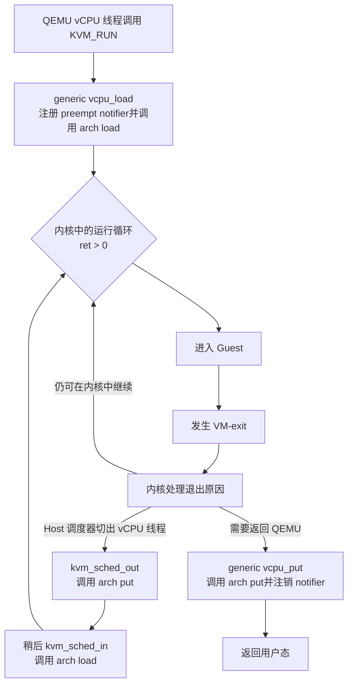
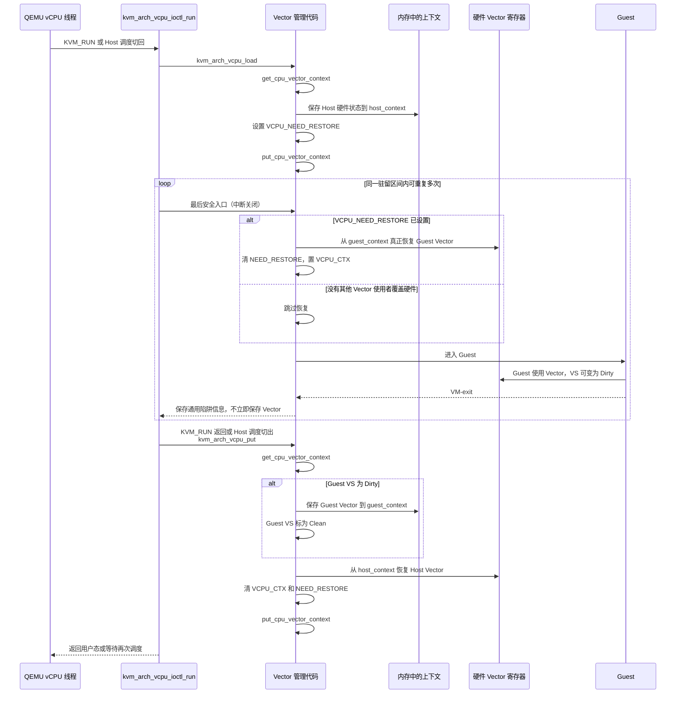
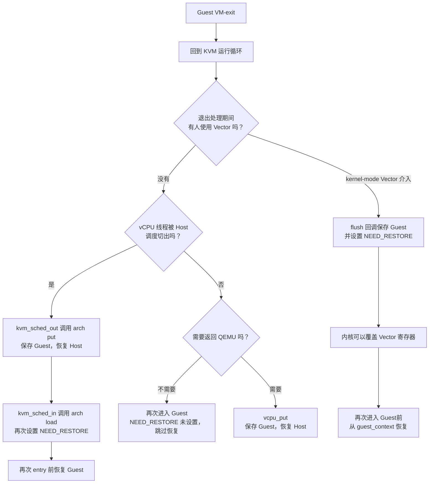
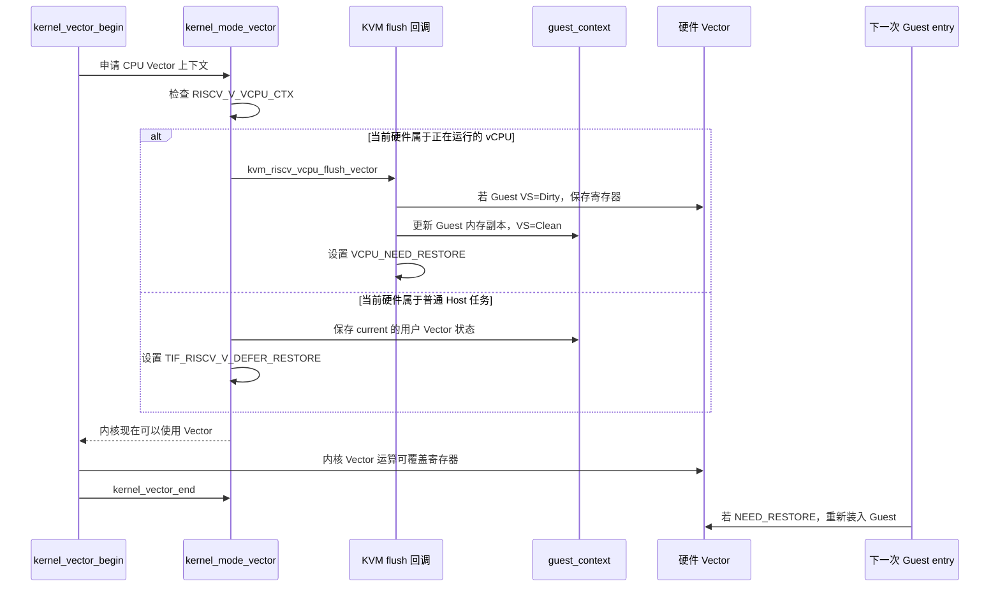
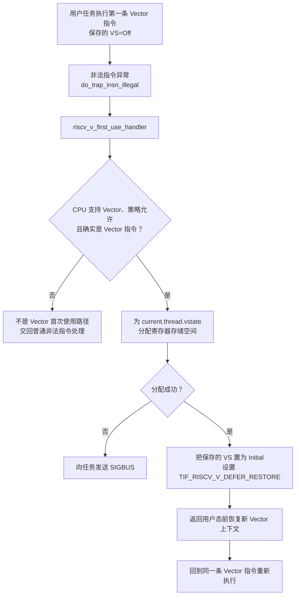
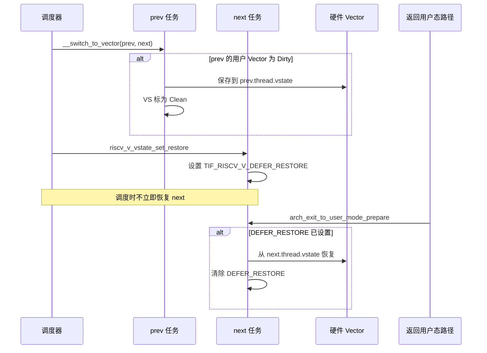
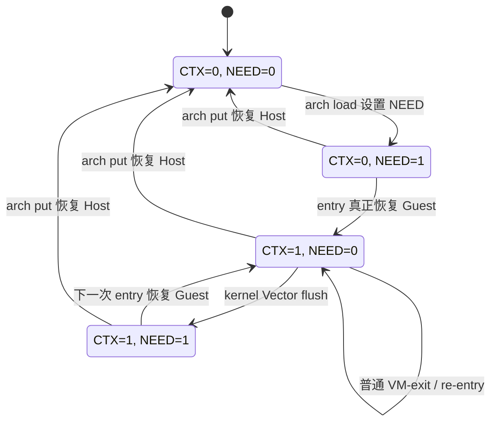

# RISC-V Vector 上下文调用链与时序图

> 基线：Linux `24a19b953e2a`（v7.3-rc7），核对日期：2026-10-17。  
> 本文只描述当前代码事实，不包含尚未实现的 `kvm_vector_owner` 方案。

## 1. 先记住三个层次

理解这条路径最重要的一点是：一次 `KVM_RUN` 内可以有很多次 Guest entry/exit；同时，
Host 调度器也可能把 QEMU vCPU 线程切出再切回。后者会通过 preempt notifier 再次调用
`kvm_arch_vcpu_put()` / `kvm_arch_vcpu_load()`。

因此，“一次 VM-exit”不等于“一次完整 Vector 保存/恢复”。连续的 entry/exit 如果没有
调度切出或其他 Vector 使用者介入，可以直接复用 Guest 硬件状态；但 vCPU 线程一旦被 Host
调度器切出，当前 `kvm_arch_vcpu_put()` 仍会保存 Guest并恢复 Host，切回时又重新装入 Guest。
这正是项目需要重点量化的调度边界。

对应入口：

- `arch/riscv/kvm/vcpu.c:891`：`kvm_arch_vcpu_ioctl_run()`
- `arch/riscv/kvm/vcpu.c:588`：`kvm_arch_vcpu_load()`
- `arch/riscv/kvm/vcpu.c:660`：`kvm_arch_vcpu_put()`
- `arch/riscv/kvm/vcpu.c:803`：`kvm_riscv_vcpu_enter_exit()`
- `virt/kvm/kvm_main.c:165`：外层 `vcpu_load()` 和 preempt notifier 注册
- `virt/kvm/kvm_main.c:6405` 附近：`kvm_sched_in()` / `kvm_sched_out()`

## 2. 一个 arch load/put 驻留区间的 Vector 时序

下图中的“内存副本”是 `vcpu->arch.host_context.vector` 和
`vcpu->arch.guest_context.vector`；“硬件”是当前 hart 上实际的 Vector 寄存器。一次完整
`KVM_RUN` 至少有一个这样的区间，也可能因 Host 调度切出/切回而出现多个区间。

这里有三个容易混淆的点：

1. `kvm_riscv_vcpu_guest_vector_restore()` 名字虽然叫 restore，实际上只设置
   `RISCV_V_VCPU_NEED_RESTORE`，并不搬运寄存器数据。
2. 真正的恢复发生在 `kvm_riscv_vcpu_enter_exit()` 中，位置已经非常靠近 Guest entry。
3. `kvm_riscv_vcpu_host_vector_restore()` 会真实覆盖硬件寄存器，并清除两个 vCPU Vector 标志。

对应代码：

- `arch/riscv/kvm/vcpu_vector.c:55`：只设置 `RISCV_V_VCPU_NEED_RESTORE`
- `arch/riscv/kvm/vcpu.c:822`：entry 前执行 `__kvm_riscv_vector_restore()`
- `arch/riscv/kvm/vcpu_vector.c:71`：恢复 Host 并清 vCPU 标志

## 3. 为什么普通 VM-exit 不会每次都恢复 Vector

所以后续做性能统计时，不能简单地用“VM-exit 次数”推算“Vector restore 次数”。真正需要统计的是：

- `__kvm_riscv_vector_restore()` 实际调用次数；
- `vcpu_load()` 次数；
- preempt notifier 引起的 `kvm_arch_vcpu_load/put()` 次数；
- kernel-mode Vector 触发的 flush 次数；
- `vcpu_put()` 次数及 Guest `VS=Dirty` 的比例。

## 4. kernel-mode Vector 介入时的保护链

内核准备使用 Vector 时，必须先保护当前硬件内容。若硬件里是 KVM Guest 状态，通用
kernel-mode Vector 代码会通过已注册的 KVM 回调把 Guest 状态保存下来。

关键入口：

- `arch/riscv/kernel/kernel_mode_vector.c:100`：`__riscv_flush_vector_context()`
- `arch/riscv/kvm/vcpu_vector.c:100`：`kvm_riscv_vcpu_flush_vector()`
- `arch/riscv/kernel/kernel_mode_vector.c:250`：`kernel_vector_begin()`
- `arch/riscv/kernel/kernel_mode_vector.c:275`：`kernel_vector_end()`

注意：flush 后当前代码保留 `RISCV_V_VCPU_CTX`，同时增加
`RISCV_V_VCPU_NEED_RESTORE`。这表示“逻辑上仍处于 vCPU Vector 上下文，但硬件内容在下一次
Guest entry 前必须重新装入”。

## 5. 用户任务第一次使用 Vector

`arch/riscv/kernel/vector.c` 主要负责用户 Vector 上下文的初始化、分配和控制策略。
其中与保存/恢复链最直接相关的是首次使用处理：当用户任务的 `VS=Off` 时执行第一条
Vector 指令，会先以非法指令异常进入内核。

对应代码：

- `arch/riscv/kernel/traps.c:170`：`do_trap_insn_illegal()`
- `arch/riscv/kernel/vector.c:185`：`riscv_v_first_use_handler()`
- `arch/riscv/kernel/vector.c:230`：`riscv_v_vstate_ctrl_init()`
- `arch/riscv/include/asm/entry-common.h:9`：返回用户态前完成延迟恢复

这条链解释了为什么用户任务一开始不必为 Vector 寄存器分配大块内存：只有真正执行
Vector 指令并且策略允许时，才建立 `vstate.datap`。

## 6. 普通 Linux 任务的 Vector 调度路径

这条路径与 KVM 的 vCPU 标志不同。普通用户任务通过
`TIF_RISCV_V_DEFER_RESTORE` 把恢复推迟到真正返回用户态之前。

对应代码：

- `arch/riscv/include/asm/vector.h:374`：`__switch_to_vector()`
- `arch/riscv/include/asm/vector.h:329`：`riscv_v_vstate_set_restore()`
- `arch/riscv/include/asm/entry-common.h:9`：返回用户态前真正恢复

## 7. KVM Vector 标志状态机

这张图只描述当前两个标志，不等同于未来的 per-hart owner；并假设该 Guest 已启用 V 扩展。

这解释了为什么不能把 `RISCV_V_VCPU_CTX` 直接理解成“硬件寄存器一定还是 Guest 数据”：
`CTX=1, NEED=1` 时，Guest 的可信最新值已经在内存中，硬件可以被 kernel-mode Vector 使用。

## 8. Vector 与 FP 路径的差别

RISC-V KVM 的 FP 和 Vector 并非完全同构：

| 阶段 | FP（`vcpu_fp.c`） | Vector（`vcpu_vector.c`） |
|---|---|---|
| `vcpu_load()` | 立即保存 Host、立即恢复 Guest | 保存 Host，只设置 `NEED_RESTORE` |
| Guest entry 前 | 无单独的 FP 延迟恢复步骤 | 若 `NEED_RESTORE`，才真正恢复 Guest |
| 同一 `KVM_RUN` 内重复 VM-exit | 通常保持 Guest FP | 通常保持 Guest Vector |
| `vcpu_put()` | Dirty 时保存 Guest，立即恢复 Host | Dirty 时保存 Guest，立即恢复 Host并清 vCPU 标志 |

所以本项目讨论的“延迟恢复”和“重复加载”主要针对 Vector，不能直接照搬 FP 路径的结论。

## 9. 底层 save/restore 到底搬了什么

`__riscv_v_vstate_save()` / `__riscv_v_vstate_restore()` 处理的不只是 `v0`～`v31`：

- `vstart`
- `vtype`
- `vl`
- `vcsr`
- `vlenb`
- 32 个 Vector 数据寄存器

保存数据寄存器前会执行 `vsetvli e8,m8`。也就是说，save 会先把原始 `vl/vtype` 记入内存，随后为了批量保存寄存器而改变硬件中的 `vl/vtype`。当前代码稍后有完整 restore，因此是闭合的；未来若尝试“保存后仍宣称硬件 Guest 状态可直接复用”，必须把这个副作用纳入证明。

对应代码：`arch/riscv/include/asm/vector.h:201` 和 `:238`。

## 10. 从现状图直接得到的设计约束

这些是源码事实带来的约束，不是最终方案：

1. 优化目标不能写成“消除每次 VM-exit 的 restore”，因为普通内核内 exit/re-entry 已经不恢复。
2. 真正的高频候选边界是 Host 调度造成的 `kvm_sched_out/in`，以及多次 `KVM_RUN`
   之间的 arch put/load；但当前 arch put 会恢复 Host，Guest 硬件内容确实被覆盖。
3. kernel-mode Vector 是一个独立覆盖者；任何 owner 设计都必须与 flush 回调同步。
4. `VS=Clean/Dirty` 只说明是否需要保存，不能说明寄存器属于哪个 vCPU。
5. `RISCV_V_VCPU_CTX` 也不是“某个具体 vCPU 的身份”；具体正在运行的 vCPU 由 per-CPU running-vCPU 信息提供。
6. 跳过数据搬运时仍要正确维护 `CTX/NEED_RESTORE`，否则 kernel Vector flush 会保存错对象。

## 11. 产出要求 2 对账

| 官方点名内容 | 本文覆盖位置 | 核对结果 |
|---|---|---|
| `arch/riscv/kernel/vector.c` | 第 5 节：首次使用、分配、延迟恢复 | 已覆盖 |
| `kernel_mode_vector.c` | 第 4 节：KVM/普通任务 flush 分流 | 已覆盖 |
| `arch/riscv/kvm/vcpu_fp.c` | 第 8 节：与 Vector load/put 对照 | 已覆盖 |
| `arch/riscv/kvm/vcpu_vector.c` | 第 2、4、7 节：save/restore/flush 与标志状态 | 已覆盖 |
| `vcpu_load/put` | 第 1、2 节：外层调用及调度切出/切回的重复 arch hook | 已覆盖 |
| vCPU entry/exit | 第 1～3 节：内层循环和最后安全恢复点 | 已覆盖 |
| 当前保存/恢复时序图 | 第 2 节为主，第 3～7 节展开特殊路径 | 已覆盖 |

## 12. 本文源码索引

| 主题 | 文件与入口 |
|---|---|
| KVM_RUN 外层与内层循环 | `arch/riscv/kvm/vcpu.c:891` |
| generic load/put 与调度回调 | `virt/kvm/kvm_main.c:165`～`:183`、`:6405`～`:6432` |
| vCPU load/put | `arch/riscv/kvm/vcpu.c:588`、`:660` |
| 最后安全 entry | `arch/riscv/kvm/vcpu.c:803` |
| KVM Vector save/restore/flush | `arch/riscv/kvm/vcpu_vector.c:45`～`:115` |
| KVM FP 对照 | `arch/riscv/kvm/vcpu_fp.c:20`～`:76` |
| 用户 Vector 首次使用 | `arch/riscv/kernel/vector.c:179`～`:228` |
| 通用任务 Vector 调度 | `arch/riscv/include/asm/vector.h:311`～`:405` |
| kernel-mode Vector | `arch/riscv/kernel/kernel_mode_vector.c:31`～`:289` |
| 返回用户态延迟恢复 | `arch/riscv/include/asm/entry-common.h:9`～`:20` |

