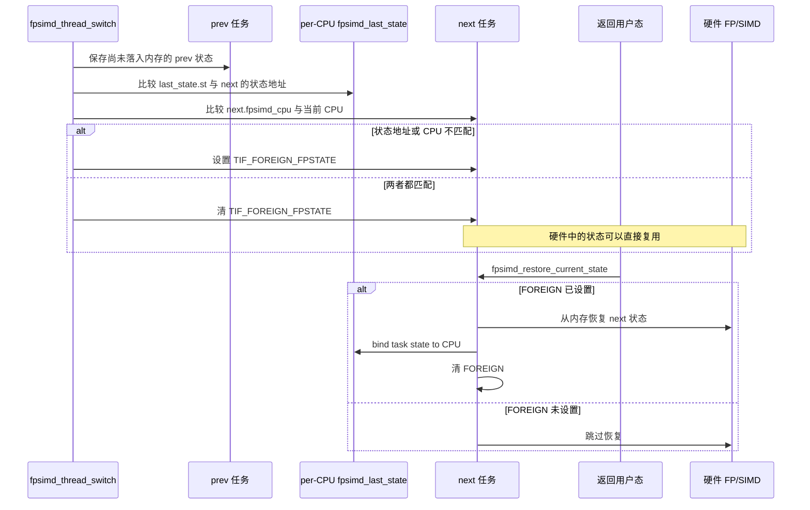
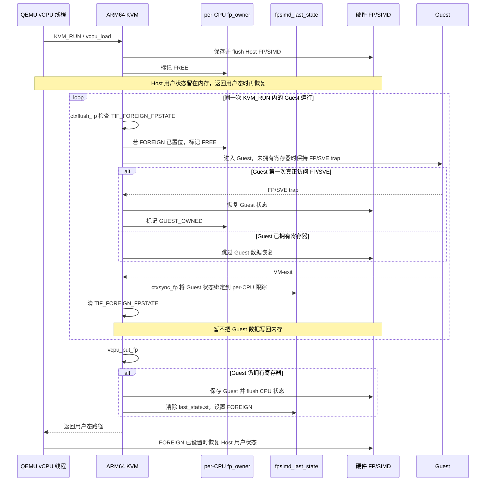
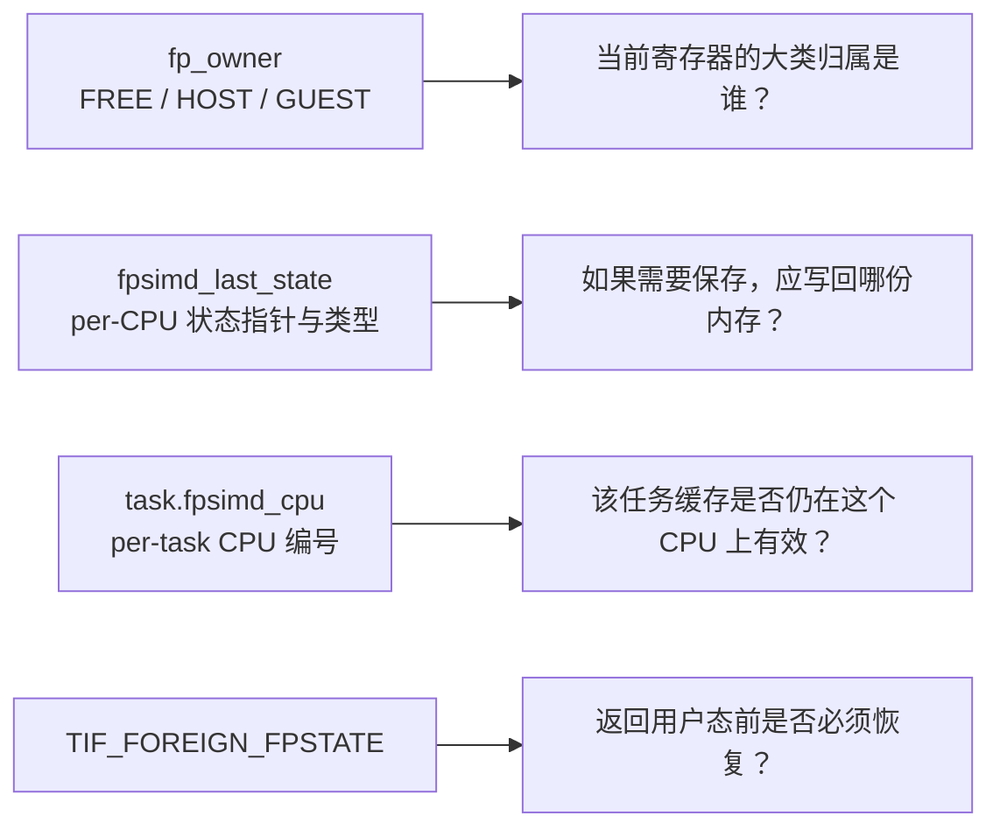
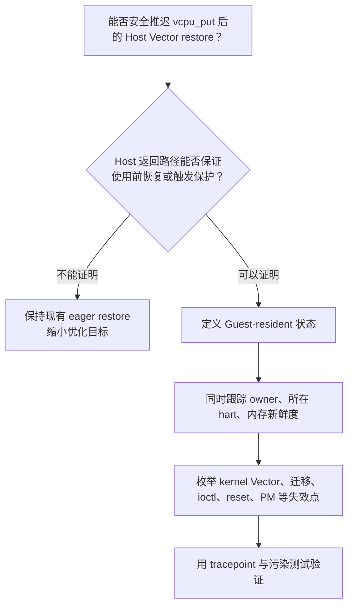

# ARM64 FPSIMD/SVE 对照与可迁移机制

> 基线：与 RISC-V 分析相同的 Linux `24a19b953e2a`（v7.3-rc7），核对日期：2026-10-17。  
> 目标是理解 ARM64 已有机制，不是证明它可以逐行移植到 RISC-V。

## 1. ARM64 普通任务的双向跟踪

ARM64 并不是只用一个 owner 指针。它把三类信息组合起来：

- per-CPU `fpsimd_last_state`：这个 CPU 最近绑定的是哪份内存状态；
- per-task `task->thread.fpsimd_cpu`：该任务的状态最后在哪个 CPU 上有效；
- `TIF_FOREIGN_FPSTATE`：当前 CPU 寄存器不是当前任务可直接使用的状态，需要在返回用户态前恢复。

这里的关键不变量是：只有“per-CPU 指针匹配”和“per-task CPU 匹配”同时成立，才能相信硬件内容仍属于这个任务。

对应源码：

- `arch/arm64/kernel/fpsimd.c:1580`：`fpsimd_thread_switch()`
- `arch/arm64/kernel/fpsimd.c:1748`：`fpsimd_bind_state_to_cpu()`
- `arch/arm64/kernel/fpsimd.c:1764`：`fpsimd_restore_current_state()`
- `arch/arm64/kernel/fpsimd.c:1821`：`fpsimd_flush_task_state()`

## 2. ARM64 KVM 的懒加载流程

ARM64 KVM 还维护 per-CPU `fp_owner`，取值是 `FREE`、`HOST_OWNED`、`GUEST_OWNED`。
它只说明 Host/Guest/Free 这一层归属；具体绑定哪一份状态仍由 `fpsimd_last_state` 等元数据完成。

关键入口：

- `arch/arm64/kvm/fpsimd.c:24`：`kvm_arch_vcpu_load_fp()`
- `arch/arm64/kvm/fpsimd.c:66`：`kvm_arch_vcpu_ctxflush_fp()`
- `arch/arm64/kvm/fpsimd.c:79`：`kvm_arch_vcpu_ctxsync_fp()`
- `arch/arm64/kvm/fpsimd.c:115`：`kvm_arch_vcpu_put_fp()`
- `arch/arm64/kvm/hyp/include/hyp/switch.h:523`：Guest entry 的 lazy 辅助逻辑
- `arch/arm64/kvm/hyp/include/hyp/switch.h:544`：Guest exit 的 lazy 辅助逻辑

`vcpu_put_fp()` 的 flush 并不直接把 `fp_owner` 写成 `FREE`；它清除的是通用
`fpsimd_last_state.st` 绑定并设置 `TIF_FOREIGN_FPSTATE`。下一次 `vcpu_load_fp()` 会重新把
`fp_owner` 初始化为 `FREE`。这一区别很重要，不能把图中的“失效”误解成某一次固定的
owner 赋值。

与 RISC-V 一样，图中的 load/put 不只发生在 `KVM_RUN` 最外层。QEMU vCPU 线程在
`KVM_RUN` 内被 Host 调度切出/切回时，KVM preempt notifier 也会调用
`kvm_arch_vcpu_put()` / `kvm_arch_vcpu_load()`，进而调用本节的 FP 协调函数。

## 3. 四组元数据各自回答什么问题

这也是对 RISC-V 方案最重要的提醒：一个 `kvm_vector_owner` 指针只能回答“像是谁”，不能单独证明内存副本是否最新、当前 hart 是否匹配、Host 是否需要恢复、kernel Vector 是否已经覆盖。

## 4. RISC-V 与 ARM64 当前实现对比

| 问题 | RISC-V KVM Vector | ARM64 KVM FPSIMD/SVE |
|---|---|---|
| Guest 何时真正加载 | 每次 `vcpu_load` 置 NEED；entry 前无条件按 NEED 恢复 | 初始保持 trap；Guest 首次访问时加载 |
| 内部 VM-exit 后是否立即保存 | 否；无覆盖者时继续保留 | 否；把 Guest 状态绑定到 per-CPU 跟踪 |
| kernel SIMD/Vector 介入 | RCU flush 回调保存 Guest并置 NEED | 通用 FPSIMD 层保存当前 owner并 flush |
| `vcpu_put` | Dirty 时保存 Guest；立即恢复 Host | Guest live 时保存并 flush；Host 用户状态可延迟到返回用户态恢复 |
| per-CPU 所有权 | 没有具体 vCPU owner；使用 vCPU 标志和 running-vCPU 信息 | 有 `fp_owner` 大类状态，加 `fpsimd_last_state` 指向具体内存状态 |
| 普通任务恢复条件 | `TIF_RISCV_V_DEFER_RESTORE` | `TIF_FOREIGN_FPSTATE` + 双向 CPU/状态匹配 |
| 可变向量长度 | RVV `VLEN`，保存 `vl/vtype/vstart/vcsr` | SVE/SME VL 和 FPSIMD 公共寄存器需协调 |
| 迁移判断 | 当前 KVM Vector 没有独立的 owner/CPU 双向缓存 | task CPU 与 per-CPU last-state 双向校验 |

## 5. ARM64 哪些思想可以迁移

可以迁移的是设计原则：

1. **双向验证，而非单点猜测**：per-hart 记录 owner，vCPU 侧也记录最后有效 hart 或版本；两边同时匹配才允许复用。
2. **保存目标必须明确**：硬件内容若尚未写回内存，必须知道将来应保存到哪一个 vCPU 的 `guest_context`。
3. **恢复尽量靠后**：直到确定下一位使用者真的需要寄存器时再搬运。
4. **覆盖者统一走失效入口**：kernel Vector、另一 vCPU、迁移、reset、寄存器 ioctl、CPU PM/hotplug 都不能绕开失效规则。
5. **把“内存是否最新”和“硬件属于谁”分开**：这两个事实不能压缩成一个布尔值。

## 6. 哪些部分不能直接照搬

1. ARM64 可以依靠 FP/SVE trap 在 Guest 第一次访问时加载；RISC-V 当前 KVM Vector 路径是在 Guest entry 前恢复，陷阱模型和状态位语义不同。
2. ARM64 的 `fp_owner` 只区分 Host/Guest/Free，并不直接保存某个 `struct kvm_vcpu *`；具体身份来自另一套状态绑定机制。
3. ARM64 在 `vcpu_put()` 时清除通用 last-state 绑定，并在下一次 `vcpu_load()` 时把
   `fp_owner` 重新设为 `FREE`。因此这套代码不能直接证明 RISC-V 应在 `vcpu_put()` 后保留
   Guest owner。
4. RISC-V 的完整 save 为了批量搬运寄存器会执行 `vsetvli`，从而改变硬件 `vl/vtype`；“保存后继续复用”的设计必须额外修复或恢复这些控制状态。
5. RISC-V 当前在 `vcpu_put()` 中真实恢复 Host Vector。因此如果不先改变 Host restore 策略，保留旧 Guest owner 会形成错误元数据。

## 7. 对下一阶段设计的直接输入

在写 owner 代码前，需要先回答下面四个问题：

当前最稳妥的结论不是“照搬 ARM64”，而是：ARM64 证明了双向跟踪和延迟恢复是成熟思路；RISC-V 是否能跨 `vcpu_put()` 保留 Guest 状态，仍需要针对本架构的 Host 返回路径和 Vector 控制寄存器副作用单独论证。

## 8. 产出要求 3 对账

| 官方点名内容 | 本文覆盖位置 | 核对结果 |
|---|---|---|
| per-CPU `last_state` | 第 1、3 节 | 已覆盖 |
| task CPU 绑定 | 第 1、3、4 节 | 已覆盖 |
| `TIF_FOREIGN_FPSTATE` 延迟恢复 | 第 1、2 节 | 已覆盖 |
| ARM64 KVM FPSIMD/SVE 关系 | 第 2、4 节 | 已覆盖 |
| 可迁移到 RISC-V KVM 的分析 | 第 5～7 节 | 已覆盖并标明不可直接照搬部分 |

## 9. 本文源码索引

| 主题 | 文件与入口 |
|---|---|
| ARM64 KVM FP 协调 | `arch/arm64/kvm/fpsimd.c:24`～`:139` |
| ARM64 vCPU load/put | `arch/arm64/kvm/arm.c:669`、`:751` |
| entry/exit 周围 ctxflush/ctxsync | `arch/arm64/kvm/arm.c:1349`、`:1391` |
| Hypervisor lazy switch | `arch/arm64/kvm/hyp/include/hyp/switch.h:523`～`:566` |
| per-CPU `fp_owner` | `arch/arm64/include/asm/kvm_host.h:758`～`:773` |
| 通用 FPSIMD last-state 机制 | `arch/arm64/kernel/fpsimd.c:450`、`:1580`～`:1867` |

