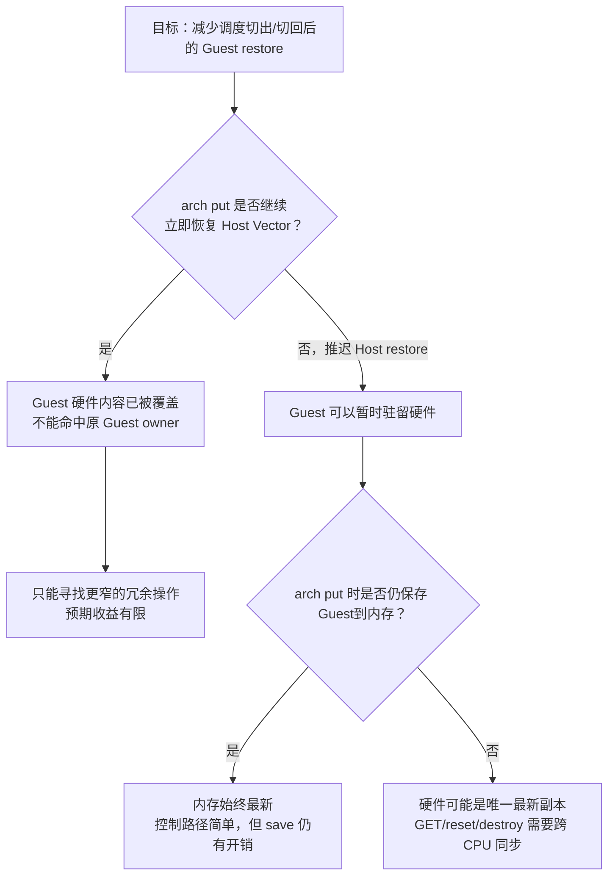

# Vector owner 设计前失效边界审计

> 基线：Linux `24a19b953e2a`（v7.3-rc7），核对日期：2026-10-17。  
> 本文是产出要求 4 的输入，不是最终设计，也没有修改 owner 相关代码。

## 1. 本轮要回答的问题

在定义 per-hart Vector owner 前，先核实四件事：

1. `kvm_arch_vcpu_put()` 是否真的用 Host 数据覆盖硬件 Vector；
2. vCPU 线程被 Host 调度切出/切回时，是否重复经过 arch put/load；
3. `KVM_GET/SET_ONE_REG`、reset、destroy 是否一定经过 arch put/load；
4. CPU hotplug/PM 和不同内核配置会怎样影响失效规则。

结论是：前两项都成立；第三项不成立；第四项已有可复用的本 CPU 清理入口，但尚未处理未来的 Vector owner。

## 2. 已确认的两个基础事实

### 2.1 Host restore 是真实的数据覆盖

`kvm_riscv_vcpu_host_vector_restore()` 在 Host 支持 V 时调用
`__kvm_riscv_vector_restore()`，后者会执行 `vle8.v` 装入 32 个 Vector 寄存器，并恢复
`vstart/vtype/vl/vcsr`。随后它清除 `RISCV_V_VCPU_CTX` 和
`RISCV_V_VCPU_NEED_RESTORE`。

因此，只要当前 arch put 保持不变，put 之后就不能继续声称硬件内容属于原 Guest。

### 2.2 同一次 KVM_RUN 内也可能重复 arch put/load

外层 `vcpu_load()` 注册 preempt notifier。vCPU 线程被 Host 调度器切出时：

```text
kvm_sched_out()
  -> kvm_arch_vcpu_put()
     -> 保存 Guest Vector
     -> 恢复 Host Vector
```

切回时：

```text
kvm_sched_in()
  -> kvm_arch_vcpu_load()
     -> 保存 Host Vector
     -> 设置 Guest NEED_RESTORE
```

所以真正值得量化的高频边界不只是多次用户态 `KVM_RUN`，还包括一次 `KVM_RUN` 内的
Host 调度抢占。

## 3. F-1～F-7 逐项源码审计

| 边界 | 当前源码事实 | 对未来 owner 的要求 |
|---|---|---|
| F-1：arch put 恢复 Host | `vcpu.c:660` 调 Guest save，再调用 Host restore；硬件被覆盖 | 保持当前流程就必须清 owner；若想保留 owner，必须先重构 Host restore 策略 |
| F-2：同 hart 运行另一 vCPU | 新 vCPU 的 arch load/entry 会装入它自己的状态 | 新 owner 覆盖旧 owner前，必须保证旧 owner 的内存副本最新 |
| F-3：kernel Vector | `__riscv_flush_vector_context()` 看到 `VCPU_CTX` 后调用 KVM flush；Dirty 时保存并置 NEED | flush 保存完成后必须令硬件缓存失效，或转入明确的 reload-pending 状态 |
| F-4：GET/SET_ONE_REG | 通用 ioctl 只持有 `vcpu->mutex`，不会调用 `vcpu_load/put`；Vector get/set 直接访问 `guest_context` 内存 | SET 会让硬件缓存变旧，必须失效；若允许“最新 Guest 数据只在硬件”，GET 也必须先同步，否则会读到旧内存 |
| F-5：vCPU 迁移 | 调度切出在源 CPU arch put，切入目标 CPU arch load；当前总是保存/恢复，所以安全 | 快路径必须同时验证 owner 身份和 hart；源 hart 缓存必须失效或带版本 |
| F-6：reset/destroy | loaded reset 会先 arch put；未 loaded reset 直接改内存。destroy 直接释放 `vector.datap` | owner 若跨 put 存活，未 loaded reset 和 destroy 都可能留下远端陈旧指针，必须远程清理或使用不解引用旧指针的版本机制 |
| F-7：CPU hotplug/PM | `kvm_riscv_csr_cleanup()` 已在 CPU offline、非保持 idle entry 时清 `kvm_former_vcpu` | 可在同一本 CPU 清理入口失效 Vector owner；resume 不能沿用掉电前所有权 |

### 3.1 GET_ONE_REG 也是边界

原交接草案重点列出了 `KVM_SET_ONE_REG`，但如果将来采用“Guest 最新数据可只留在硬件、
内存稍旧”的激进方案，`KVM_GET_ONE_REG` 同样会成为同步点：它当前直接从
`guest_context.vector` 复制给用户态，不会主动向远端 hart 索取最新寄存器。

这意味着设计必须二选一：

- 始终保证 arch put 后 Guest 内存副本最新；或者
- 允许硬件成为最新副本，但为 GET、reset、destroy 等控制路径增加同步协议。

第二种方案侵入范围和并发复杂度明显更高。

## 4. 配置差异不会消除核心不变量

| 配置 | 当前差异 | owner 设计中不变的要求 |
|---|---|---|
| `CONFIG_RISCV_ISA_V=n` | Vector helper 走空 stub；本项目已修复其构建缺口 | 新接口也必须有可编译 stub |
| `CONFIG_RISCV_ISA_V_PREEMPTIVE=y` | 增加可抢占 kernel Vector 的嵌套深度、Dirty/NEED_RESTORE 管理 | kernel Vector 第一次取得寄存器前仍必须保护 Guest 状态 |
| `CONFIG_RISCV_ISA_V_PREEMPTIVE=n` | `kernel_vector_begin()` 走非抢占式 fallback | 仍通过 `__riscv_flush_vector_context()` 分流 KVM Guest |
| `CONFIG_PREEMPT_RT=y` | `get_cpu_vector_context()` 使用 `preempt_disable()`；非 RT 通常使用 `local_bh_disable()` | owner 的读取、更新和失效必须处于同一 CPU Vector 临界区 |

所以配置会改变临界区和嵌套实现，但不会改变“硬件被覆盖就必须失效”“内存与硬件只能有一个明确最新来源”这两个核心不变量。

## 5. 当前三个设计方向



还要注意：当前 `__riscv_v_vstate_save()` 为保存数据会执行 `vsetvli e8,m8`，改变硬件
`vl/vtype`。即使选择“put 时保存 Guest但保留寄存器”，也不能在不恢复控制状态的情况下
直接把它视为可再次运行的完整 Guest 状态。

## 6. 下一步设计任务

下一步不是立刻增加一个 `struct kvm_vcpu *owner`，而是先完成以下状态模型：

1. 分别定义“硬件归属”“Guest 内存是否最新”“Host 是否需要恢复”三个维度；
2. 明确 arch load、Guest entry/exit、sched out/in、kernel Vector、GET/SET、reset/destroy、
   hotplug/PM 的状态转换；
3. 先选择“内存始终最新”的保守模型作为最小可验证版本，再评估是否值得扩大为硬件唯一最新副本；
4. 为每条转换指定可观测 tracepoint，之后再实现快路径。

## 7. 源码依据

| 事实 | 源码入口 |
|---|---|
| arch load/put | `arch/riscv/kvm/vcpu.c:588`、`:660` |
| 调度切出/切回 | `virt/kvm/kvm_main.c:6405`～`:6432` |
| Vector Host/Guest save/restore | `arch/riscv/kvm/vcpu_vector.c:45`～`:76` |
| kernel Vector flush | `arch/riscv/kernel/kernel_mode_vector.c:100`、`arch/riscv/kvm/vcpu_vector.c:100` |
| ONE_REG 通用 ioctl | `virt/kvm/kvm_main.c:4435`～`:4680` |
| RISC-V Vector ONE_REG | `arch/riscv/kvm/vcpu_vector.c:172`～`:226` |
| reset/destroy | `arch/riscv/kvm/vcpu.c:93`～`:119`、`:209`～`:226` |
| CPU offline/PM 清理 | `arch/riscv/kvm/main.c:40`～`:124` |

