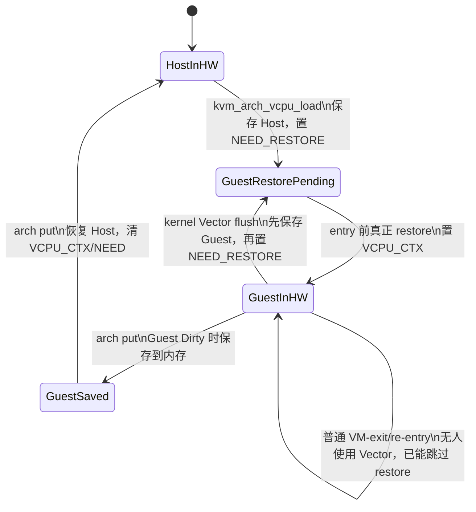

# RISC-V KVM Vector 所有权与有效性状态机（设计初稿）

> 基线：Linux `24a19b953e2a`（v7.3-rc7）  
> 状态：产出要求 4 初稿，尚未启用任何运行时快路径。  
> 目标读者：刚开始阅读内核/KVM 代码的开发者。

## 1. 先说结论

`owner` 不能只表示“上一次运行的是哪个 vCPU”，它必须表示：

> **此刻，这个 hart 的硬件 Vector 寄存器是否仍完整保存着某个主体的最新状态。**

所以，按当前主线代码不作其他改动时：

- `kvm_arch_vcpu_put()` 保存 Guest 后会把 Host Vector 恢复进硬件；
- 硬件已经不再保存 Guest，Guest `owner` **必须清除**；
- 如果不清，下一次把“旧 owner”当作命中并跳过 restore，Guest 会读到 Host 数据，属于隔离错误。

这也暴露了申请书初版执行方案中的核心缺口：如果 F-1 在每次 put 都清 owner，后续 load
就不可能命中；如果不清，owner 又是假的。要获得跨 put/load 的收益，不能只增加一个
`struct kvm_vcpu *owner`，还必须安全地延迟 Host restore，并接入 Host task、调度器和
kernel Vector 对硬件状态的接管路径。

## 2. 三个容易混淆的概念

把 Vector 寄存器想成一块只有一个人的“白板”：

1. **硬件归属（hardware owner）**：白板上现在是谁的内容；
2. **内存新鲜度（memory freshness）**：这个人的内存备份是否包含最新内容；
3. **恢复义务（restore obligation）**：下一个使用者是否必须先把自己的内存备份写回白板。

单个 owner 指针只能回答第 1 个问题，回答不了后两个问题。例如：保存 Guest 时
`__riscv_v_vstate_save()` 会先保存 `vstart/vtype/vl/vcsr`，然后执行 `vsetvli` 和向量 store。
数据寄存器已经保存到内存，但硬件中的 `vl/vtype/vstart` 不再等于原 Guest 状态。此时说
“硬件仍属于 Guest”不够精确：数据寄存器可能还对，控制状态已经不完整。

## 3. 设计状态

### 3.1 每 hart 的硬件状态

概念上先定义下列状态；最终 C 结构不一定照搬枚举名称：

| 字段 | 值 | 含义 |
|---|---|---|
| `owner_kind` | `NONE/HOST_TASK/GUEST_VCPU/KERNEL` | 当前硬件内容属于谁 |
| `owner_ptr` | task 或 vCPU 指针 | 只在相应 kind 下有意义 |
| `data_valid` | true/false | v0-v31 是否仍与 owner 的状态一致 |
| `ctrl_valid` | true/false | vstart/vl/vtype/vcsr 是否仍一致 |
| `generation` | 整数 | owner 的内存版本；防止 reset/set-reg 后误命中旧硬件 |

只有以下条件全部满足，才允许 Guest 跳过完整 restore：

```text
owner_kind == GUEST_VCPU
&& owner_ptr == vcpu
&& owner_cpu == smp_processor_id()
&& owner_generation == vcpu->vector_generation
&& data_valid
&& ctrl_valid
```

### 3.2 每 vCPU 的内存状态

| 状态 | 含义 | 允许的操作 |
|---|---|---|
| `MEM_CURRENT` | `guest_context.vector` 是最新完整副本 | GET/reset/destroy 可直接处理 |
| `HW_NEWER` | 最新内容只在某 hart 的硬件中 | 必须先跨 CPU 同步，才能 GET/reset/destroy |

第一版设计固定采用 `MEM_CURRENT`：硬件即将被别人覆盖前，先把 Dirty Guest 保存到内存。
这样会保留一次 save 的成本，但大幅降低并发、销毁和 ABI 风险。`HW_NEWER` 暂不实现。

### 3.3 Host 恢复状态

| 状态 | 含义 |
|---|---|
| `HOST_NOT_NEEDED` | Host 用户态 VS=Off，没有需要恢复的用户 Vector 状态 |
| `HOST_SAVED` | Host 状态已保存，硬件暂被 Guest 占用 |
| `HOST_RESTORE_PENDING` | Host 即将使用 Vector 或返回用户态，必须先恢复 |
| `HOST_ACTIVE` | 硬件已装入 Host 状态 |

这部分不能凭 KVM 的 owner 指针推断，必须与 RISC-V task Vector 的
`task_pt_regs(current)->status`、`TIF_RISCV_V_DEFER_RESTORE` 和调度切换语义协调。

## 4. 当前主线实际状态机



这里已经说明：普通的内部 VM-exit/re-entry 不是新优化的主要目标；真正重复发生完整
save/restore 的高频路径是 Host 调度导致的 `kvm_sched_out/in -> arch put/load`。

## 5. 为什么不能直接让 owner 跨 put 存活

通用 KVM 的顺序是：

```text
kvm_sched_out()
  kvm_arch_vcpu_put(vcpu)
  this_cpu_write(kvm_running_vcpu, NULL)
```

普通 `vcpu_put()` 也是先调用 arch put，然后注销 preempt notifier，再清
`kvm_running_vcpu`。而 RISC-V kernel Vector 目前用 `RISCV_V_VCPU_CTX` 决定是否调用
KVM flush 回调；该回调再从 `kvm_running_vcpu` 取 vCPU。

因此，跨 put 保留 Guest 有两个都不安全的朴素做法：

| 朴素做法 | 后果 |
|---|---|
| 保留 `RISCV_V_VCPU_CTX` | put 后 `kvm_running_vcpu == NULL`，回调找不到 vCPU，当前代码会告警 |
| 清 `RISCV_V_VCPU_CTX`，只保留 owner | kernel Vector/Host task 不知道硬件仍是 Guest，可能按 Host 状态处理并覆盖；owner 随即变成假命中 |

此外，`__switch_to_vector(prev, next)` 按 Host task 的状态保存/标记恢复，并不读取 KVM
owner。故只改 `arch/riscv/kvm/` 无法覆盖“vCPU 线程已被调度走、另一 Host task 开始运行”
这一关键边界。

## 6. 两级实现路线

### M0：只观测，不改行为（下一步）

先实现恢复计数/trace，回答三个量化问题：

1. Guest 完整 Vector restore 实际发生多少次；
2. 其中多少次来自 arch load，多少次来自 kernel Vector flush；
3. arch put 时 Host 用户 VS=Off 的比例有多高。

`kvm_riscv_vcpu_enter_exit()` 是 `noinstr`，不能在其中直接调用普通 tracepoint。
安全方案是让该函数以布尔值返回“本次是否真的 restore”，回到普通可插桩上下文后再记
trace/counter；或先只在安全的 NEED_RESTORE 产生点统计请求次数。实现前以 objtool/noinstr
构建结果为准。

### M1：保守的完整所有权模型

满足以下条件后才进入行为优化：

- Guest 内存始终保持 `MEM_CURRENT`；
- 所有覆盖硬件的入口都能原子地失效 per-hart owner；
- Host task 需要 Vector、kernel Vector 开始、任务切换、返回用户态前都能正确接管；
- owner 生命周期不会跨过 vCPU 销毁，或用 generation/同步清理避免悬空与 ABA；
- Dirty Guest save 改写控制 CSR 后，不能把状态错误地标为 `ctrl_valid`。

这个模型很可能需要在通用 RISC-V Vector 路径增加一个轻量失效/交接 hook，因而申请书的
“改动只限 `arch/riscv/kvm/`”目前应降级为偏好，而不是已经证明可行的约束。

### M2：允许硬件比内存新（暂不采用）

M2 可以连 Guest save 也推迟，但 GET_ONE_REG、reset、destroy、迁移都可能需要向远端 hart
索取最新状态，涉及 IPI、对象生命周期和并发同步。当前阶段没有必要承担这部分风险。

## 7. 关键事件的状态转换

下表是实现评审的最低检查单。任何一行没有确定动作，都不能打开 skip-restore 快路径。

| 事件 | 内存动作 | 硬件 owner 动作 | 后续恢复 |
|---|---|---|---|
| Guest entry，owner 精确命中且全有效 | 无 | 保持 Guest | 只建立正确的 active/CTX 状态，可跳过数据 restore |
| Guest entry，owner 未命中 | 从内存恢复 | 设为该 Guest、全有效 | 无 |
| 普通 VM-exit 后马上 re-entry | 无 | 保持 Guest | 当前主线已可跳过 |
| arch put（当前主线） | Dirty 时保存 Guest | Host restore 后设 Host/清 Guest owner | 下次 Guest 必须 restore |
| arch put（未来延迟 Host） | Dirty 时保存；必要时恢复 Guest 控制 CSR | 暂存 Guest，但注册 Host/调度接管义务 | 只有所有接管 hook 完备后才允许 |
| kernel_vector_begin | 先保存当前 owner 的 Dirty 状态 | 设为 Kernel/清 Guest 命中 | Guest 或 Host 下次使用时恢复 |
| Host 任务切换 | 保存需要保存的当前主体 | 转给 next 或设 NONE | next 使用前恢复 |
| GET_ONE_REG | M1 直接读最新内存 | 不一定失效 | 无 |
| SET_ONE_REG | 写内存并递增 generation | 所有旧硬件缓存失效 | Guest 下次 entry 恢复 |
| vCPU reset | 清内存并递增 generation | 所有旧硬件缓存失效 | 下次 entry 恢复初始值 |
| vCPU destroy | 先同步清除所有 owner 引用 | 不得留下指针 | 释放后不得再比较/解引用旧对象 |
| vCPU 迁移 | 源 hart 保存并失效；目标检查 CPU+generation | 目标重新设 owner | 首次迁入必须恢复 |
| CPU offline/非保持 PM | 内存必须已最新 | 清本 hart owner | resume 后首次使用恢复 |

## 8. 不变量（代码与测试都必须证明）

1. **隔离**：Guest 永远不能读到 Host、kernel 或另一 vCPU 的寄存器残留；
2. **唯一性**：一个 hart 同一时刻最多只有一个硬件 owner；
3. **命中真实性**：只有 data、控制 CSR、CPU、generation 全匹配才算命中；
4. **内存可见性**：M1 下，控制面操作看到的 `guest_context.vector` 始终是最新完整副本；
5. **生命周期**：销毁 vCPU 前，不得留下可形成误命中的 owner 引用；
6. **配置完整性**：`CONFIG_RISCV_ISA_V=n` 仍能构建，PREEMPT_RT/可抢占 kernel Vector
   不能改变上述语义；
7. **noinstr**：Guest EQS 静默区内只允许明确可用于 noinstr 的简单状态操作，不直接 trace。

## 9. 设计决策与待确认项

### M0 实测反馈

稳定 L2 的 idle 与固定 100 次 RVV 窗口中，153/153 和 1826/1826 次实际 restore 均来自
`vcpu_load` 请求，`kernel_vector` 请求为 0，Host 用户态 VS 均为 Off。说明当前环境的主要
恢复源确实是调度触发的 arch load，而且“Host VS=Off”是值得优先优化的常见情形。

这只是必要条件，不是充分条件：task switch 后 `riscv_v_flags` 随 task 切换，另一 Host task
仍可能接管 Vector；所以不能据此直接让 KVM owner 跨 put 存活。

### 已决定

- 当前代码下，put 后 Guest owner 必须清；不允许“指针留着但含义模糊”。
- 第一版坚持 Guest 内存始终最新，不实现硬件唯一最新副本。
- P1 先做行为不变的量化；P2-P4 不再原样照抄，必须等 M1 的 Host/task 接管路径闭环。
- `KVM_GET_ONE_REG` 也是 M2 的同步边界；在 M1 中因内存始终最新而无需额外同步。

### 需要导师/上游评审的设计问题

1. 是否接受为 Host/task 与 kernel Vector 增加通用的所有权交接 hook；
2. 如果坚持只改 `arch/riscv/kvm/`，是否接受结论：可安全实现的收益范围可能非常窄；
3. 第一版是否只针对 Host 用户 VS=Off 的情况保留 Guest，并把其他情况全部回退到现状；
4. owner 用远端清理、generation，还是二者结合来解决 reset/destroy 生命周期问题。

## 10. 与 OSPP 产出的对应关系

- 本文承接产出要求 2 的现状调用链和产出要求 3 的 ARM64 机制分析；
- 本文给出产出要求 4 所需的 owner、有效、Dirty、失效和迁移规则框架；
- M0 为产出要求 5/6 的实现建立基线数据；
- 第 8 节是不破坏 ABI、隔离和抢占边界（产出要求 7）的设计证明清单。

## 11. 源码依据

| 事实 | 入口 |
|---|---|
| arch load/put 保存恢复 | `arch/riscv/kvm/vcpu.c:588`、`:660` |
| entry 前最后时刻 restore | `arch/riscv/kvm/vcpu.c:803`～`:827` |
| Host/Guest Vector helper | `arch/riscv/kvm/vcpu_vector.c:45`～`:76` |
| kernel Vector 分流 | `arch/riscv/kernel/kernel_mode_vector.c:105`～`:118` |
| task 切换 | `arch/riscv/include/asm/vector.h:374`～`:405` |
| KVM 调度切出后清 running_vcpu | `virt/kvm/kvm_main.c:6405`～`:6432` |
| 普通 vcpu_put 后清 running_vcpu | `virt/kvm/kvm_main.c:165`～`:183` |

